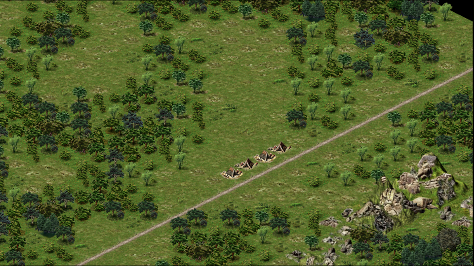
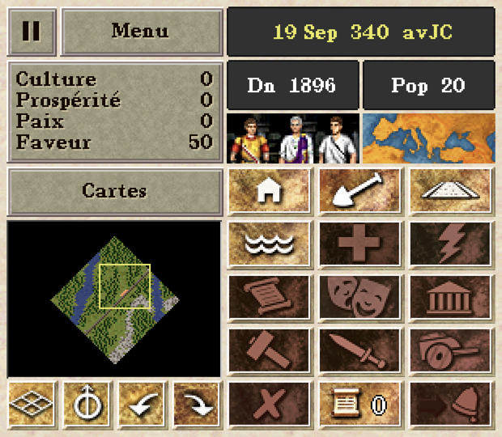
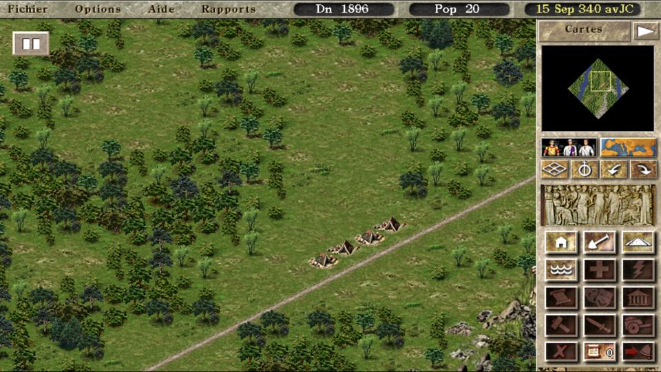

> [!IMPORTANT]
> Just so you know, this whole fork was built with Claude, Anthropic's AI
> assistant, in Claude Code. I decided what to build and tried every change on
> my Thor.

# Caesar III Thor

Caesar III (1998) on the AYN Thor, using both screens. It's a fork of
[Augustus](https://github.com/Keriew/augustus), which runs the original game
from your own copy.

- The top screen shows the city, and nothing else.
- The bottom screen holds the rest: date, money, ratings, minimap, build
  buttons and menus, redrawn in HD.
- Messages and building info open below, so they never hide the city.
- The controls are mapped: sticks for the cursor and the map, triggers to zoom.
- Select switches to the original layout on one screen.

<p align="center">
  
  <br>
  
</p>

## What you need

- An AYN Thor (tested on Android 13).
- Caesar III, patched to version 1.0.1.0. The CD, GOG and Steam versions work.

> [!NOTE]
> This repository and the APK contain no game files.

## Install

1. Download the APK from the
   [releases](https://github.com/simonbrtrnd/augustus-thor/releases) and open
   it on the Thor. The app is called Caesar III Thor. It installs next to the
   official Augustus app.
2. Copy your Caesar III folder to the Thor, for example to the SD card.
3. Open the app and pick that folder. Your saves go in the same folder.

## Controller

Buttons are named as printed on the Thor: B bottom, A right, Y left, X top.

| Button | Action |
| --- | --- |
| Left stick | Move the cursor; slow for precision, fast when pushed all the way |
| Right stick | Move the map, or scroll a window |
| B | Left click; in a list below, choose the highlighted item |
| A | Right click; shows the info of what is under the cursor |
| Y | Pause |
| X | Hide or show the overlay |
| L1, R1 | Rotate the map; in the advisors, show the previous or next one |
| L2, R2 | Zoom out, zoom in; hold to zoom smoothly |
| D-pad up, down | Game speed, shown for 3 seconds; in a window, scroll it; in a list below, move the highlight |
| D-pad left, right | Previous, next overlay; in a list below, change column |
| Select | Switch between one and two screens |

## Touch

On the top screen, tap to click, drag to move the map and pinch to zoom. To
build, draw a road or place a building, then tap the check button at the top
right to confirm it, or the cross to cancel.

With nothing to build, tap anything on the map to see its info below. Tap
something else to see its info instead, or the same thing again to close it.

On the bottom screen, tap a button to use it. Drag on the minimap to move the
view, and drag in a long window to scroll it.

While a window is open on top, tapping the bottom screen closes it, then does
what you tapped. This works for the advisors, the settings and the save
windows. Settings you have not applied are lost. Tapping the button that opened
the window only closes it.

To type a save name or a filter, tap the text field. The keyboard opens on the
top screen.

## One screen or two

Press Select to switch between two layouts:

- Two screens: the city on top, the panel below.
- One screen: the whole game on top, as in the original. The bottom screen
  turns black.

<p align="center">
  
</p>

Messages and building info open on the bottom screen. To keep them on top,
turn off Show windows on the second screen, in Menu, Options, User Interface.

## Permissions

The app asks for no permissions. It only uses the game folder you pick.

## Build the APK

You need JDK 17, and NDK 29.0.14206865 and CMake 4.1.2 from the Android SDK
manager.

```sh
git clone -b thor --recursive https://github.com/simonbrtrnd/augustus-thor.git
cd augustus-thor
curl -L https://www.libsdl.org/release/SDL2-2.32.10.tar.gz | tar -xz -C ext/SDL2
curl -L https://www.libsdl.org/projects/SDL_mixer/release/SDL2_mixer-2.8.2.tar.gz | tar -xz -C ext/SDL2
cd android
./gradlew assembleDebug
```

The APK is in `android/augustus/build/outputs/apk/debug/`. The project path
must not contain spaces.

## Feedback

Found a bug, or have an idea? Open an
[issue](https://github.com/simonbrtrnd/augustus-thor/issues).

## Credits and license

- Augustus is made by Keriew and contributors, from Julius by Bianca van
  Schaik. Its [manual](https://github.com/Keriew/augustus/tree/master/res/manual)
  explains its gameplay changes.
- This fork uses the same license as Augustus, the AGPL 3.0.
- The HD buttons are redrawn from the game's art, partly with ChatGPT.
- Caesar III was made by Impressions Games and published by Sierra. This
  project is not affiliated with the game's rights holders or with AYN.
